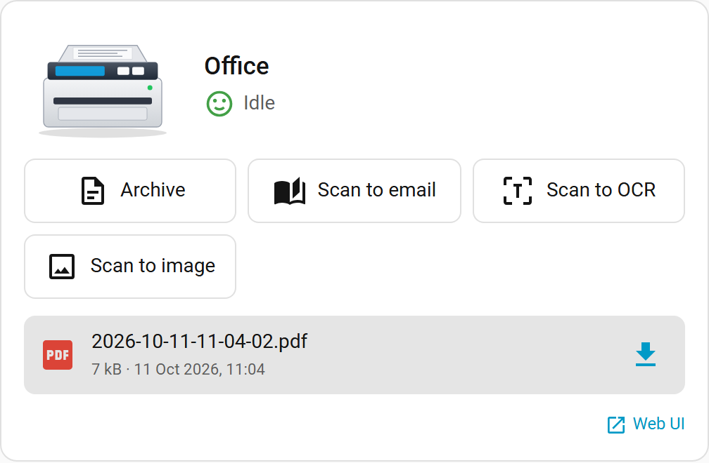

# Brother Scanner (Docker) for Home Assistant

[](https://github.com/hacs/integration)
[](https://github.com/PhilippMundhenk/ha-brother-scanner/actions/workflows/validate.yml)

A Home Assistant integration for [BrotherScannerDocker](https://github.com/PhilippMundhenk/BrotherScannerDocker): the container that drives a network Brother scanner and turns scans into PDFs, with optional OCR. The integration talks to the container's REST API, so Home Assistant can start scans, show what the scanner is doing and hand out the finished PDFs.

A [dashboard card](#dashboard-card) comes with the integration: it is served and registered as a dashboard resource by the integration, nothing to install separately.

This is an independent, third-party project. It is not affiliated with or endorsed by Brother Industries, Ltd.; Brother is a trademark of Brother Industries, Ltd. and is used only to describe which devices the container works with. No Brother logo or artwork is included.

## What you get

One device per container, with these entities:

| Entity | Type | Content |
| --- | --- | --- |
| State | sensor (enum) | `idle`, `scanning`, `waiting_for_rear`, `converting`, `ocr`, `unreachable`. Attributes: current job, pages, waiting job, OCR queue, the actions with their labels, device capabilities, picture URL, web UI URL |
| Last scan | sensor | Name of the newest PDF. Attributes: size, time, download URL through Home Assistant, direct URL, OCR copy |
| OCR queue | sensor | Scans waiting for OCR; attributes: in progress, failed, holding |
| Last job, Last error, Container version | diagnostic sensors | State of the newest job, its error text, the image version |
| Scanning, Waiting for rear pages, OCR running, Scanner reachable, Problem | binary sensors | What the web UI shows with its icons |
| Scan-to-PC registered | binary sensor | The scanner itself says it currently lists the container as a Scan-to-PC destination, i.e. its buttons reach us (container 2.2+, read over SNMP) |
| Panel display | sensor | The first line of the scanner's own display; attributes: model, serial, firmware, whether network scanning and the scan key are supported and enabled (container 2.2+) |
| Scan key enabled | diagnostic binary sensor | The device has its network Scan-to-PC key enabled (container 2.2+) |
| One button per scan action | button | Named like the container's buttons (`RENAME_GUI_*`), disabled actions (`DISABLE_GUI_*`) are created disabled |
| Scan rear pages | button | Only when the container's email action is disabled (that action is the web UI's rear-pages button); available while a scan waits for its rear pages |
| Resolution, Mode, Source | select (config) | Options from the device (`scanimage -A` at container start); `Container default` leaves the container's setting in charge |

Services (all return response data):

- `brother_scanner.scan` with `target` (`file`, `ocr`, `email`, `image`), optional `resolution`, `mode`, `source`, `wait`; returns the job id
- `brother_scanner.scan_rear` with optional `job`
- `brother_scanner.download_last_scan` with `path` (a file, or a directory with a trailing slash) and optional `ocr: true`; the path must be inside `allowlist_external_dirs`

Events on the bus, each with job id, state, file names and download URLs: `brother_scanner_scan_started`, `brother_scanner_waiting_for_rear`, `brother_scanner_scan_done`, `brother_scanner_scan_failed`, `brother_scanner_ocr_done`. Every payload also says who started the job (`trigger`: `button` on the device or `api`) and which Scan-to-PC `function` it was.

A press of a Scan-to-PC button **on the scanner itself** additionally fires `brother_scanner_button_pressed` (same payload; `function` is `file`, `ocr`, `email` or `image`, and `button` carries what the button daemon reported, such as the sequence number and the per-press fields, when the container runs [openskey](https://github.com/PhilippMundhenk/openskey)). Scans started from Home Assistant, the web UI or the API do not fire it. Needs container 2.2 or newer; older containers do not report the trigger.

Downloads go through Home Assistant (`/api/brother_scanner/<entry>/download/<file>`), so the browser only needs to reach Home Assistant and the container's API token stays on the server.

## Dashboard card

The integration comes with a dashboard card. It is served by the integration and registered as a dashboard resource when the integration starts, so there is nothing else to install: after installing or updating the integration and restarting Home Assistant, reload the browser and add the card (Edit dashboard → Add card → **Brother Scanner Card**).

The card shows the scanner (a picture, the name and the state with the same icons as the container's web UI), the scan buttons with the labels configured in the container, a highlighted button while a scan waits for its rear pages (with the countdown), the OCR queue, the last scan with download buttons for the PDF and its OCR copy, and a link to the web UI. With container 2.2 or newer it also shows what the scanner itself reports: whether it currently lists the container as a Scan-to-PC destination (so the buttons on the device work), its panel display line, and on request serial number and firmware; every one of these can be switched off.



The visual editor covers every option. In YAML:

```yaml
type: custom:brother-scanner-card
entity: sensor.office_scanner_state   # the integration's "State" sensor
name: Office scanner                  # optional, default: the device name
show_image: true                      # picture from the integration (generic by model, or the configured URL)
image: /local/my-scanner.png          # optional, overrides the picture
show_buttons: true
buttons: [file, ocr]                  # optional: only these actions (file, ocr, email, image)
show_selects: false                   # resolution / mode / source dropdowns
show_last_scan: true
show_link: true                       # link to the container's web UI
compact: false
show_device: true                     # the scanner's own state (container 2.2+); each value below can be switched off
show_registered: true                 #   "Scan-to-PC registered" (the scanner lists the container; red when it does not)
show_display: true                    #   the scanner's panel display line
show_serial: false                    #   serial number
show_firmware: false                  #   firmware version
show_scan_key: true                   #   warn when the device has its network scan key switched off
```

The card finds the other entities of the scanner (buttons, selects, last scan) through the device of the state sensor, so only the state sensor needs to be configured. Disabled actions (`DISABLE_GUI_*` in the container) do not get a button; renamed actions (`RENAME_GUI_*`) show their label. Downloads go through the integration's authenticated download endpoint (the card asks for a signed URL first), so they work from outside the local network as well and the container's API token never reaches the browser.

How the card is loaded:

- With dashboard resources in storage mode (the default), the integration adds one resource, `/brother_scanner/card/brother-scanner-card.js?v=<version>`, of type JavaScript module, and updates its version after each update of the integration so the browser fetches the new file. Removing the integration removes the resource.
- With `lovelace: resource_mode: yaml`, where the resources are yours, the integration does not touch them and loads the card on every frontend page instead. Nothing to add by hand.

**Coming from the separate card** (`brother-scanner-card`, installed as a HACS custom repository or by hand): the card is now part of this integration and that repository is no longer maintained. Remove the old card in HACS (Frontend → Brother Scanner Card → Remove) or delete its resource under Settings → Dashboards → Resources; the integration logs a warning while the old copy is still registered. Until then the card keeps working, but the browser console may show an error from the old copy. Your dashboards keep working unchanged, the card type stays `custom:brother-scanner-card`.

## Requirements

- BrotherScannerDocker from October 2026 or newer (`GET /api/actions` answers with `api_version`), running with `WEBSERVER=true`
- Home Assistant 2024.8 or newer

## Installation

### HACS (custom repository, until the integration is in the default store)

[](https://my.home-assistant.io/redirect/hacs_repository/?owner=PhilippMundhenk&repository=ha-brother-scanner&category=integration)

The badge opens the repository in your HACS; by hand:

1. HACS → Integrations → menu (three dots) → **Custom repositories**
2. Repository `https://github.com/PhilippMundhenk/ha-brother-scanner`, category **Integration**, Add
3. Search for "Brother Scanner (Docker)", Download, restart Home Assistant

### Manual

Copy `custom_components/brother_scanner` into your `config/custom_components/` folder and restart Home Assistant.

## Setup

Settings → Devices & services → Add integration → **Brother Scanner (Docker)**. Enter the host and port of the container's web interface. The API token is only needed when the container runs with `API_TOKEN`.

Setup asks for the address of the container's web interface: a host name or IP, or a full URL such as `https://scanner.example.org` or `http://192.168.1.5:8080`. The port may stay empty (80, or 443 with HTTPS). A `404 page not found` answer in the setup dialog comes from a reverse proxy in front of the container: the name or port does not reach the container's web interface, which must be at the root of the address.

Options (gear icon on the integration): poll interval (default 5 s), a picture URL for the card, or hide the picture, and whether to poll the scanner's own state (`GET /api/scanner/device`: registration, panel display, firmware; on by default, the container caches it so polling costs the device little). Without a URL the card shows a generic illustration chosen by the model family (MFC/DCP, ADS, DS). With a container older than 2.2 the device-state entities stay unavailable and everything else works.

## Automations

Move every finished scan to a folder Paperless watches:

```yaml
alias: Scan to Paperless
triggers:
  - trigger: event
    event_type: brother_scanner_ocr_done
actions:
  - action: brother_scanner.download_last_scan
    data:
      path: /media/paperless/consume/
      ocr: true
```

React to a button on the scanner itself (for example, light up a lamp while the Scan-to-OCR shortcut is used):

```yaml
triggers:
  - trigger: event
    event_type: brother_scanner_button_pressed
    event_data:
      function: ocr
actions:
  - action: light.turn_on
    target:
      entity_id: light.office_desk
```

Start a gray 300 dpi scan from a button on the wall and announce the result:

```yaml
actions:
  - action: brother_scanner.scan
    data:
      target: file
      resolution: 300
      mode: True Gray
    response_variable: scan
  - action: notify.mobile_app_phone
    data:
      message: "Scan {{ scan.job }} started"
```

## Without this integration

The container's API also works with Home Assistant's built-in `rest` sensor and `rest_command`; see the "Home Assistant" section of the [container README](https://github.com/PhilippMundhenk/BrotherScannerDocker#home-assistant). This integration adds the config flow, the dynamic buttons, the capabilities, events, the download proxy and the card.

## Development

```sh
pip install -r requirements_test.txt
pytest

cd card
npm install
npm run build        # builds custom_components/brother_scanner/www/brother-scanner-card.js
npm test             # builds, then Playwright tests against a harness with a fake hass object
```

The card's sources are in `card/` (TypeScript and Lit). Its bundle is committed in `custom_components/brother_scanner/www/`, because Home Assistant serves it from there; CI rebuilds it and fails when the committed bundle is not current. The card carries the integration's version from `manifest.json`, so one version covers both.

The tests run a fake container (an aiohttp server speaking the container's API) and exercise the config flow, entities, services, events and the download view. For a test against the real thing, start the container's end-to-end image (`tests/e2e` in BrotherScannerDocker) and add it through the UI.

A release tag `vX.Y.Z` must match `version` in `manifest.json`; the Release workflow checks it and attaches a zip of the integration.

## License

MIT, like the container.
